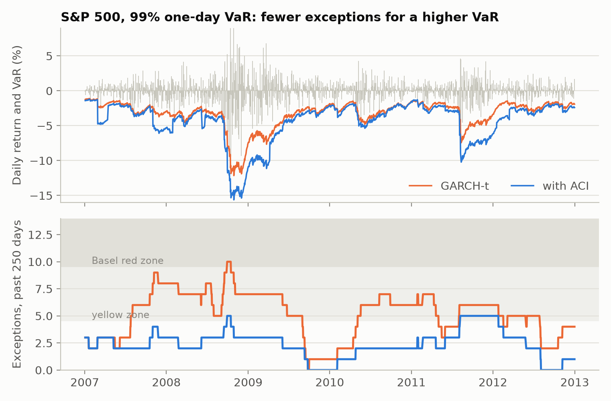
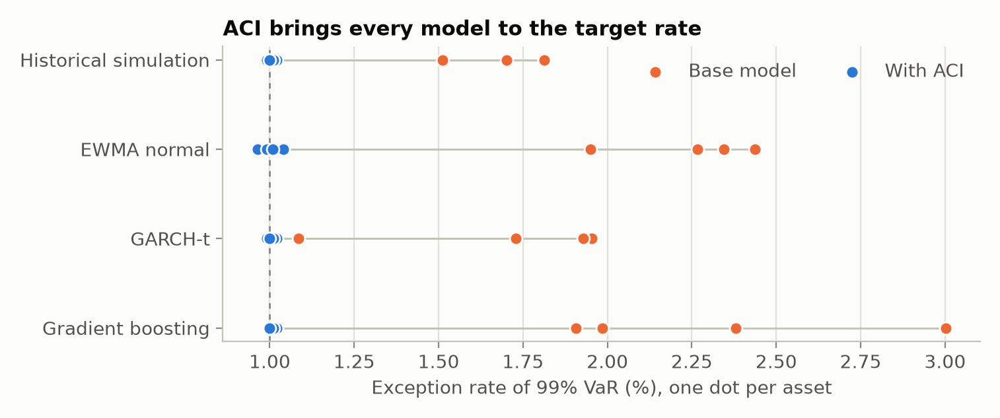

# conformal-var

[](https://github.com/Pearmaleka/conformal-var/actions/workflows/ci.yml)

Value-at-Risk forecasts with online conformal calibration, tested with the backtests that risk
managers and regulators use.

A 99% one-day VaR should be breached on 1% of days. On S&P 500, NASDAQ, crude oil and USD/JPY
data, four standard models (historical simulation, RiskMetrics, GARCH-t, gradient-boosted
quantile regression) breach it on 1.1% to 3.0% of days. Online conformal methods correct a
forecast from its own recent errors and guarantee the long-run breach rate for any sequence of
returns. This repository implements three of them and checks what that guarantee is worth.

**Findings, 99% VaR, 4 assets × 4 models:**

- **Adaptive conformal inference fixes how often.** All 16 cases land between 0.96% and 1.04%.
  The Kupiec test rejects 0 of 16, against 15 of 16 for the raw models, and no 250-day window
  reaches the Basel red zone.
- **It does not fix when.** Breaches still cluster: the dynamic quantile test rejects all 16.
- **It costs capital, and accuracy.** The VaR is 32% higher on average, and the pinball loss,
  the proper score for a quantile forecast, is slightly worse than the raw model's (+1.4%).
  With a smaller step than the paper's default the cost falls a lot (see
  [sensitivity](#sensitivity-to-the-step-size)).
- **The cheaper methods trade the other way.** Rolling conformal and quantile tracking raise the
  VaR by 16 to 19% and improve the pinball loss in 13 and 15 of 16 cases, but leave breach
  rates of 1.2% on average.

<picture>
  <source media="(prefers-color-scheme: dark)" srcset="docs/figures/exceptions-sp500-dark.png">
  
</picture>

## Quick start

```bash
pip install "git+https://github.com/Pearmaleka/conformal-var"
```

```python
import numpy as np
from conformal_var import backtest, calibrate, garch_t, load_returns

r = load_returns("sp500")  # daily log returns in percent, 1999-2018
base = garch_t(r, alpha=0.01)  # forecast for day t uses returns up to t - 1
cal = calibrate(base.to_numpy(), r.to_numpy(), alpha=0.01, method="aci")
ok = ~np.isnan(cal.q)
print(backtest(r.to_numpy()[ok], cal.q[ok], alpha=0.01))
```

| S&P 500, 99% VaR | Breach rate | Kupiec p | Christoffersen CC p | DQ p | Pinball loss | Mean VaR |
|---|---:|---:|---:|---:|---:|---:|
| GARCH-t | 1.73% | < 0.001 | < 0.001 | < 0.001 | 0.0353 | 2.49% |
| GARCH-t + ACI | 0.99% | 0.96 | 0.14 | 0.017 | 0.0374 | 3.14% |

## Methods

All forecasts are one day ahead and use returns up to the previous close only; the tests check
this for every model and calibrator.

**Base models** ([`forecasters.py`](src/conformal_var/forecasters.py)):

| Model | Forecast |
|---|---|
| Historical simulation | empirical quantile of the last 250 returns |
| EWMA normal (RiskMetrics) | normal quantile with an EWMA variance, λ = 0.94 |
| GARCH-t | GARCH(1,1) with Student-t errors, refit every 250 days on all past data |
| Gradient boosting | quantile loss on lagged returns and volatility features, refit every 250 days |

**Calibration** ([`calibration.py`](src/conformal_var/calibration.py)). A method moves the base
forecast to `q_t = q̂_t − c_t`. With the score `s_t = q̂_t − r_t`, a breach happens exactly when
`s_t > c_t`, so each method tracks the (1 − α)-quantile of the scores in its own way:

| Method | Correction `c_t` | Guarantee |
|---|---|---|
| Rolling conformal | conformal quantile of the last 500 scores | exact only if scores are exchangeable |
| ACI (Gibbs and Candès, 2021) | conformal quantile at a level `α_t` that moves after each day: `α_{t+1} = α_t + γ(α − err_t)`, γ = 0.005 | `\|breach rate − α\| ≤ (max(α, 1 − α) + γ) / (γT)` for any sequence |
| Quantile tracking (Angelopoulos et al., 2023) | `c_{t+1} = c_t + η_t(err_t − α)`, η_t = 0.01 × largest recent score | `\|breach rate − α\| ≤ (2B + η) / (ηT)` for scores bounded by B, fixed η |

ACI's guarantee needs an infinite VaR on the rare days when `α_t` drops to about 1/500. By
default such days use the largest score in the window instead, which keeps the VaR finite; the
guarantee is then approximate, and the tests check the exact version with the cap switched off.

**Backtests** ([`backtests.py`](src/conformal_var/backtests.py)):

| Test | Null hypothesis |
|---|---|
| Kupiec (1995) proportion of failures | breach probability is α |
| Christoffersen (1998) independence and conditional coverage | breaches are independent, with probability α |
| Engle and Manganelli (2004) dynamic quantile | breaches are unpredictable from past breaches and the VaR itself |
| Basel traffic light | share of 250-day windows with 0–4 (green), 5–9 (yellow), 10+ (red) breaches |
| Pinball loss | lower is better; the strictly consistent score for a quantile |

## Results

[`experiments/evaluate.py`](experiments/evaluate.py) runs every model with every calibration
on four assets. All 16 combinations are scored on the same days: from the first day on which all
have a forecast (after 1,000 days of model history and 500 days of calibration scores) to the end
of the data.

| Asset | Source | Evaluated | Days |
|---|---|---|---:|
| S&P 500 | `arch` sample data | 2004-12 to 2018-12 | 3,530 |
| NASDAQ Composite | `arch` sample data | 2004-12 to 2018-12 | 3,530 |
| WTI crude oil | FRED, via `arch` | 1991-11 to 2019-01 | 6,820 |
| USD/JPY | FRED, via [datasets/exchange-rates](https://github.com/datasets/exchange-rates) | 1977-01 to 2026-11 | 12,498 |

### 99% VaR

Totals over 4 assets × 4 base models. Test columns count rejections at 5%.

| Calibration | Breach rate, mean (range) | Kupiec | Christoffersen CC | DQ | Mean VaR vs. raw | Pinball loss vs. raw | Basel red windows |
|---|---|---:|---:|---:|---:|---:|---:|
| None | 1.99% (1.09–3.00%) | 15 / 16 | 15 / 16 | 15 / 16 | — | — | 7.3% |
| Rolling conformal | 1.21% (1.01–1.67%) | 3 / 16 | 7 / 16 | 14 / 16 | +19% | −3.5% | 1.0% |
| Quantile tracking | 1.22% (0.79–1.56%) | 6 / 16 | 8 / 16 | 11 / 16 | +16% | −4.0% | 1.9% |
| ACI | 1.01% (0.96–1.04%) | 0 / 16 | 3 / 16 | 16 / 16 | +32% | +1.4% | 0% |

<picture>
  <source media="(prefers-color-scheme: dark)" srcset="docs/figures/hit-rates-dark.png">
  
</picture>

How much a method helps depends on the base model. ACI improves the pinball loss of gradient
boosting, the worst-calibrated model (−2.0%), and makes GARCH-t worse (+4.9%). At 99%, the best
pinball loss on both equity indices comes from GARCH-t with rolling conformal. Per-case numbers are
in [`experiments/results/evaluation.csv`](experiments/results/evaluation.csv).

### 95% VaR

The raw models breach 5.95% of days on average (Kupiec rejects 15 of 16). ACI gives 4.98–5.18%
with no Kupiec rejections, for a VaR 12% higher and an unchanged pinball loss (+0.2%). The
dynamic quantile test rejects all 16 again.

### Sensitivity to the step size

GARCH-t base model, averages over the four assets (`--sensitivity`):

| ACI step γ | 0.001 | 0.002 | 0.005 (default) | 0.01 | 0.02 | 0.05 |
|---|---:|---:|---:|---:|---:|---:|
| Breach rate, 99% VaR | 1.00% | 1.00% | 1.01% | 1.01% | 1.01% | 1.01% |
| Mean VaR (raw 3.13%) | 3.59% | 3.66% | 3.87% | 4.14% | 4.31% | 4.68% |
| Pinball loss (raw 0.0441) | 0.0440 | 0.0447 | 0.0467 | 0.0498 | 0.0513 | 0.0544 |

| Tracking step | 0.001 | 0.003 | 0.01 (default) | 0.03 | 0.1 |
|---|---:|---:|---:|---:|---:|
| Breach rate, 99% VaR | 1.87% | 1.52% | 1.26% | 1.15% | 1.07% |
| Mean VaR | 3.17% | 3.25% | 3.39% | 3.46% | 3.70% |
| Pinball loss | 0.0455 | 0.0442 | 0.0437 | 0.0440 | 0.0456 |

With these data, a five times smaller ACI step than the paper's default still holds the 1% rate
and matches the raw model's pinball loss. The defaults were fixed before the evaluation and are
not tuned on it; the table is there to show the trade-off, not to pick a winner after the fact.

## Testing

```bash
pytest
```

- Hypothesis property tests check the ACI and quantile-tracking coverage bounds on arbitrary
  score sequences, including adversarial ones.
- The backtests hold their size on simulated data under the null (rejection rate near 5%) and
  detect clustered breaches. The Kupiec and Christoffersen statistics are checked against the
  formulas by hand.
- GARCH-t recovers the true conditional quantile of simulated GARCH-t data (correlation > 0.97).
- For every model and every calibrator, changing future returns leaves past forecasts unchanged.

CI runs ruff, mypy and the tests on Python 3.10 to 3.13.

## Limitations

- Long positions only (the lower tail), one asset at a time.
- Equity indices are price returns without dividends; the `arch` sample data end in 2018.
- The backtests' p-values are asymptotic, and the 16 cases share data, so the rejection counts
  are descriptive rather than a joint test.
- Expected shortfall, now the Basel market-risk measure, is not covered.

## Reproducing

```bash
pip install -e ".[dev]"
python experiments/evaluate.py --sensitivity   # about two minutes
```

Results go to `experiments/results/` and figures to `docs/figures/`.

## References

- Angelopoulos, A. N., Candès, E. J. and Tibshirani, R. J. (2023). Conformal PID control for time
  series prediction. *NeurIPS 36*.
- Basel Committee on Banking Supervision (1996). Supervisory framework for the use of
  "backtesting" in conjunction with the internal models approach to market risk capital
  requirements.
- Christoffersen, P. F. (1998). Evaluating interval forecasts. *International Economic Review*,
  39(4), 841–862.
- Engle, R. F. and Manganelli, S. (2004). CAViaR: conditional autoregressive value at risk by
  regression quantiles. *Journal of Business & Economic Statistics*, 22(4), 367–381.
- Gibbs, I. and Candès, E. (2021). Adaptive conformal inference under distribution shift.
  *NeurIPS 34*.
- Kupiec, P. H. (1995). Techniques for verifying the accuracy of risk measurement models.
  *Journal of Derivatives*, 3(2), 73–84.
- J.P. Morgan/Reuters (1996). *RiskMetrics: Technical Document*, 4th edition.

## License

MIT
